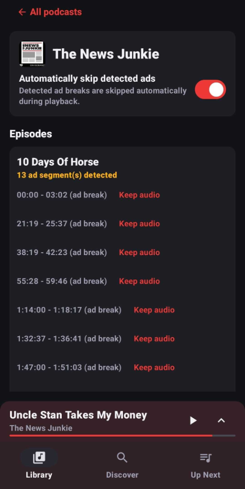

# Unsplice

Unsplice is an Android podcast app that finds and skips advertisements automatically. The app detects commercial breaks in three ways:

1. **Waveform comparison**: Compares loudness waveforms with publisher markers to calculate the duration of an ad.
2. **Chapter data**: Reads chapter data in the audio file and the feed to identify labeled sponsor segments.
3. **Audio fingerprinting**: Uses audio fingerprinting (digital summaries of sound) to find sponsor messages that repeat across episodes.

When an episode reaches a detected advertisement, the player jumps past it immediately. You can turn off automatic skipping for any podcast, or you can choose to play a specific segment manually.

