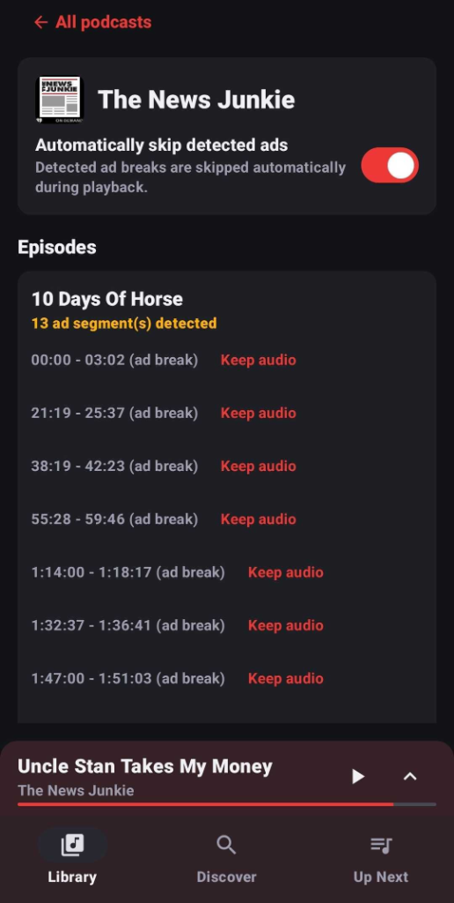

# Unsplice

Unsplice is an Android podcast app that skips ads. It downloads episodes and scans the audio on your phone to find ad breaks. The player jumps past clear ad breaks automatically and shows a "Skip ad" button for uncertain ones.

## How it finds ads

Unsplice skips an ad break automatically when one of three strong signals matches:

- The app reads chapter lists in the audio file and the podcast feed to find labeled ad breaks. It skips ad chapters in the audio file automatically, and it skips feed ad chapters when the downloaded audio matches the feed length.
- Omny Studio and ART19 insert ads during download and publish break positions with an ad-free waveform (a graph of loudness). After each break position, Unsplice slides that waveform forward until the audio matches again, and that gap is the ad.
- Audio fingerprints (short digital summaries of sound) let Unsplice find ads that repeat inside an episode or across downloaded episodes.

For weaker signals, the player shows a manual "Skip ad" button instead. Unsplice scans timed transcripts (text with timestamps) for sponsor wording and looks for sudden loud stretches between pauses. The app inspects MP3 files for changes in encoding (bitrate, sample rate, or channels) that point to a stitched-in ad. Weak waveform matches and feed ad chapters with a mismatched length also stay manual.

When the downloaded audio matches the feed length, Unsplice compares strong transcript matches and sponsor timestamps in show notes against MP3 encoding changes. If both ends of a match line up with an encoding change, the player skips that ad break automatically.

## Playback controls

If the player skips part of the show, tap "Undo skip" to go back. You can keep any flagged segment so the player stops skipping it. For any podcast, you can set skip times for intros and outros or turn automatic skipping off.

